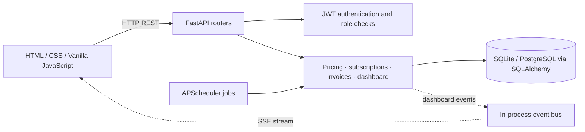

<div align="center">

# Brightloop
### Subscription Management & Recurring Billing Platform

A full-stack subscription operations app for managing the lifecycle from **quotation to payment**—with role-based access, automated recurring invoices, and live dashboard updates.

[Features](#-features) · [Quick start](#-quick-start) · [Demo accounts](#-demo-accounts) · [Architecture](#-how-the-project-is-built) · [Testing](#-testing)

</div>

---

## At a glance

Brightloop brings subscription workflows together in one web application. Administrators manage the catalog and team, billing staff handle quotations and invoices, and customers can view their own subscriptions and payment history. The backend applies pricing, tax, discount, and lifecycle rules; scheduled jobs can run recurring billing and close eligible subscriptions.

| | |
|---|---|
| **Backend** | Python 3 · FastAPI · SQLAlchemy · Pydantic |
| **Frontend** | HTML · CSS · Vanilla JavaScript |
| **Data** | SQLite by default; PostgreSQL-compatible via `DATABASE_URL` |
| **API** | REST · JWT authentication · interactive OpenAPI/Swagger docs |
| **Background work** | APScheduler · in-process Server-Sent Events (SSE) |

## ✨ Features

- **Three role-based experiences:** admin, billing staff, and customer access are scoped to their responsibilities.
- **Subscription lifecycle management:** draft, quotation, confirmed, active, paused, and closed states with allowed transitions.
- **Recurring billing:** daily, weekly, monthly, and yearly plans; invoice generation for due subscription periods; scheduled billing support.
- **Catalog and pricing:** products, variants, quantities, configurable taxes, and quotation templates.
- **Discounts:** fixed-value or percentage offers with eligibility and usage rules.
- **Invoices and payments:** issue, confirm, send, and print invoices; record partial payments and track balances.
- **Operations dashboard:** subscription and invoice metrics, normalized monthly recurring revenue (MRR), overdue items, and revenue trends.
- **Live updates:** Server-Sent Events refresh dashboard data without requiring a page reload.
- **Customer self-service:** customers can view their own subscriptions and invoices; account signup and password reset flows are included.
- **Background maintenance:** scheduled billing and eligible subscription auto-close tasks.
- **Database safeguards:** a unique subscription-and-period constraint prevents duplicate recurring invoices; indexes support common list and dashboard queries.

## 🚀 Quick start

### Requirements

- Python 3.10+ recommended
- Git
- Windows, macOS, or Linux

### Option 1: Launch with the included script

Clone the repository and enter its directory:

```bash
git clone https://github.com/suraj-mm/subsription_management_system.git
cd subsription_management_system
```

**Windows (Command Prompt):**

```bat
run.bat
```

**macOS / Linux:**

```bash
chmod +x run.sh
./run.sh
```

The launcher creates a `.env` from `.env.example` if needed, creates a virtual environment, installs dependencies, initializes and seeds the local database on first run, and starts the server.

Open:

- **Application:** <http://localhost:8000>
- **Interactive API docs:** <http://localhost:8000/docs>
- **Health check:** <http://localhost:8000/health>

### Option 2: Run each setup step yourself

From the repository root:

1. **Clone and enter the project.**

   ```bash
   git clone https://github.com/suraj-mm/subsription_management_system.git
   cd subsription_management_system
   ```

2. **Create and activate a virtual environment.**

   ```bash
   # Windows PowerShell
   python -m venv venv
   .\venv\Scripts\Activate.ps1

   # macOS / Linux
   python3 -m venv venv
   source venv/bin/activate
   ```

3. **Install Python dependencies.**

   ```bash
   python -m pip install --upgrade pip
   pip install -r requirements.txt
   ```

4. **Set up local configuration.** Copy `.env.example` to `.env` and adjust values if required.

   ```bash
   # macOS / Linux
   cp .env.example .env

   # Windows Command Prompt
   copy .env.example .env
   ```

5. **Initialize demo data.** For a fresh database, run:

   ```bash
   python seed.py
   ```

   To reset and reseed an existing local database, use `python seed.py --reset`. **This resets local demo data.**

6. **Start the API and web app.**

   ```bash
   uvicorn backend.app.main:app --host 0.0.0.0 --port 8000 --workers 1
   ```

7. **Open the app** at <http://localhost:8000> and sign in with one of the demo accounts below.

> **Why one worker?** The current SSE event bus is in-process memory. Run with a single Uvicorn worker so API requests, scheduled jobs, and event subscribers share that process-local bus.

## 🔐 Demo accounts

The seed script supplies demo users and records. Use these credentials to explore each role:

| Role | Email | Password | Explore |
|---|---|---|---|
| Administrator | `admin@brightloop.com` | `Admin@12345` | Dashboard, catalog, staff, and billing operations |
| Billing staff | `staff@brightloop.com` | `Staff@12345` | Quotations, subscriptions, and invoices |
| Customer | `tony@stark.org` | `Customer@12345` | Customer portal and an active subscription |
| Customer | `arjun@nexustech.io` | `Customer@12345` | Customer portal and an overdue invoice |
| Customer | `alex@acme.com` | `Customer@12345` | Customer portal and paid invoice history |
| Customer | `rachel@globex.in` | `Customer@12345` | Customer portal and paused subscription |

These are **development/demo credentials only**. Never reuse them in a deployed environment.

### Suggested first walkthrough

1. Sign in as the administrator and review the dashboard.
2. Open **Invoices** and use **Generate Now** to run recurring billing against subscriptions due for invoicing.
3. Check the resulting invoices and dashboard metrics; dashboard changes can appear through SSE without a manual refresh.
4. Sign in as billing staff to explore quotation and invoice workflows.
5. Sign in as a customer to verify that the portal shows that customer's records rather than another user's.

## 🏗 How the project is built

The application is a conventional three-tier web app: browser UI → FastAPI application and domain services → relational database.



### Build and request flow, step by step

1. **The browser renders the frontend.** FastAPI serves the static frontend files alongside its API. The JavaScript app communicates with the backend over HTTP and listens for dashboard events using the browser's `EventSource` API.
2. **FastAPI routes requests.** Feature routers separate authentication, administration, products, plans, taxes, quotations, subscriptions, discounts, invoices, payments, and dashboard operations.
3. **Pydantic validates inputs.** Request and response schemas define the shape and validation of data crossing the API boundary.
4. **Authentication and authorization protect actions.** JWT-based authentication identifies the caller; role checks restrict admin, staff, and customer operations. Customer data access is scoped to the signed-in customer.
5. **Services implement business rules.** Dedicated services calculate prices and taxes, enforce subscription state transitions, generate recurring invoices, and compute dashboard aggregates.
6. **SQLAlchemy persists relational data.** Models represent users, products, plans, subscriptions, invoices, line items, payments, and related configuration. SQLite is the no-setup default; the database URL is configurable.
7. **Schedulers handle recurring work.** APScheduler runs billing and auto-close maintenance jobs. The app also exposes a manual billing action for demonstrations and operations.
8. **SSE publishes live dashboard events.** Service changes are dispatched through an in-process event bus and streamed to connected browsers.

## 🧰 Technical stack & concepts demonstrated

| Area | Technologies / concepts |
|---|---|
| Backend API | Python, FastAPI, REST, OpenAPI, dependency-based request handling |
| Validation & configuration | Pydantic, Pydantic Settings, environment variables |
| Persistence | SQLAlchemy ORM, relational modeling, foreign keys, unique constraints, indexes |
| Security | Password hashing with bcrypt, JWTs, role-based access control, scoped customer access |
| Frontend | HTML5, CSS3, JavaScript, responsive UI, API integration, hash-based navigation, EventSource/SSE |
| Business logic | Subscription state machines, recurring schedules, discounts, tax calculations, partial payments, MRR normalization |
| Background tasks | APScheduler, daily maintenance and billing jobs |
| Testing & performance | Python smoke/end-to-end scripts and a query benchmark script |
| Developer tools | Git, Python virtual environments, pip, Uvicorn, browser, Swagger UI at `/docs` |

### Repository map

```text
backend/app/       FastAPI app, configuration, database, models, routers, services
frontend/          Browser UI assets
requirements.txt   Python dependencies
seed.py            Database setup and demo data
run.sh             macOS/Linux launcher
run.bat            Windows launcher
smoke_test.py      Automated smoke-test flow
test_phase*_e2e.py End-to-end test scripts
benchmark_perf.py  Query performance benchmark
.env.example       Local configuration template
```

## ⚙️ Configuration

The application reads configuration from environment variables (the launcher copies `.env.example` to `.env`). Common settings:

| Variable | Purpose | Local default |
|---|---|---|
| `SECRET_KEY` | Signs authentication/reset tokens | Development value in `.env.example` |
| `DATABASE_URL` | SQLAlchemy connection string | `sqlite:///./brightloop.db` |
| `FRONTEND_URL` | Frontend origin and reset-link base URL | `http://localhost:8000` |
| `DEBUG` | Development behavior, including reset-flow diagnostics | `True` |
| `SMTP_HOST`, `SMTP_PORT` | Optional email server | `smtp.gmail.com`, `587` |
| `SMTP_USER`, `SMTP_PASSWORD` | Optional SMTP credentials | Empty (console fallback) |
| `ADMIN_EMAIL`, `ADMIN_PASSWORD` | Initial administrator account | Demo credentials above |

For PostgreSQL, provide a SQLAlchemy-compatible PostgreSQL URL as `DATABASE_URL` and install the appropriate PostgreSQL driver. Do not commit `.env` or use development secrets, debug settings, or demo credentials in production.

## 🧪 Testing and performance checks

Run the included smoke test from the project root (with dependencies installed):

```bash
python smoke_test.py
```

Additional end-to-end scripts are provided as `test_phase1_e2e.py`, `test_phase2_e2e.py`, and `test_phase3_e2e.py`. The benchmark script can be run with:

```bash
python benchmark_perf.py
```

The project README previously reported benchmark results on a seeded dataset of roughly 3,000 subscriptions and 10,000 invoices. Treat those timings as environment- and dataset-specific; run the benchmark on your own machine before making performance comparisons.

## 🔍 Design choices worth exploring

- **Idempotent recurring invoices:** a database-level unique constraint on `(subscription_id, period_start)` helps prevent duplicate invoices for the same billing period.
- **Money-aware calculations:** prices and amounts use decimal database columns rather than binary floating-point storage.
- **Monthly revenue normalization:** daily, weekly, monthly, and yearly plan prices are converted to monthly equivalents for the MRR metric.
- **Time-dependent overdue state:** overdue status is derived from invoice due date, payment balance, and invoice status rather than becoming stale as time passes.
- **Indexed operational queries:** composite indexes support common invoice and subscription filtering.

## ⚠️ Scope and production considerations

This repository is designed to run locally and demonstrate subscription workflows. Before using it for a production service, review and harden deployment configuration, secret management, authentication/session policy, email delivery, database migrations, backups, observability, and operational error handling. The current SSE event bus is process-local; a multi-worker or multi-instance deployment needs a shared event mechanism (for example, Redis Pub/Sub) and a production database setup.

## 📄 License

No license file is currently included. Contact the repository owner before redistributing or reusing the project beyond the permissions provided by GitHub's default terms.
