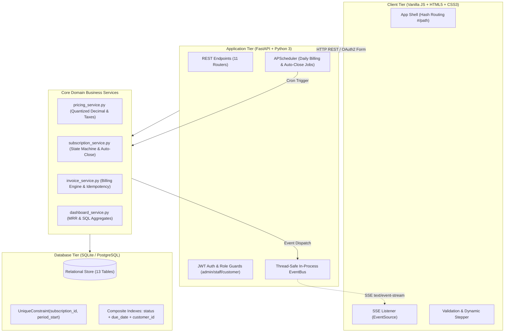

# ⚡ Brightloop — Enterprise Subscription Management Platform

> **Odoo Hackathon Kochi — Round 1 Submission**  
> Brightloop is a unified, real-time subscription lifecycle and recurring billing engine built with FastAPI, SQLite/PostgreSQL, and responsive Vanilla JavaScript. Designed strictly according to ERP integrity principles, it enforces database-level double-billing protection, multi-period recurring billing (daily/weekly/monthly/yearly), promotional discount evaluation before tax, dynamic overdue calculation, and thread-safe Server-Sent Events (SSE) updates—all running seamlessly from a single command with zero external npm or broker dependencies.

---

## ⚡ Quick Start (One Command)

The entire application (FastAPI backend + unified responsive frontend) starts in one command with zero setup:

### Windows
```cmd
run.bat
```

### macOS / Linux
```bash
chmod +x run.sh
./run.sh
```

### Manual Run
```bash
python -m venv venv
# Windows: .\venv\Scripts\activate | Linux: source venv/bin/activate
pip install -r requirements.txt
python seed.py --reset
uvicorn backend.app.main:app --host 0.0.0.0 --port 8000 --workers 1
```

- 🌐 **Web App:** [http://localhost:8000](http://localhost:8000)
- 📚 **Swagger API Docs:** [http://localhost:8000/docs](http://localhost:8000/docs)
- 🩺 **System Health Check:** [http://localhost:8000/health](http://localhost:8000/health)

---

## 🔑 Demo Login Accounts

All accounts are pre-seeded via `seed.py` with realistic enterprise data:

| Role | Email | Password | What to Test |
| :--- | :--- | :--- | :--- |
| **Administrator** | `admin@brightloop.com` | `Admin@12345` | Full dashboard, catalog, user & staff management, billing trigger |
| **Billing Staff** | `staff@brightloop.com` | `Staff@12345` | Quotation templates, subscription confirmation, invoice operations |
| **Customer (Active)** | `tony@stark.org` | `Customer@12345` | Stark Industries — active subscription due today |
| **Customer (Overdue)** | `arjun@nexustech.io` | `Customer@12345` | Nexus Tech — invoice overdue, red badge in portal |
| **Customer (Paid)** | `alex@acme.com` | `Customer@12345` | Acme Corp — historical paid subscription & invoices |
| **Customer (Paused)** | `rachel@globex.in` | `Customer@12345` | Globex Logistics — paused subscription & quotation |

> 🎯 **5-Minute Evaluator Live Demo Flow:**
> 1. Log in as **Administrator** (`admin@brightloop.com` / `Admin@12345`).
> 2. Open two browser windows: one with the **Dashboard** and one with **Invoices**.
> 3. Go to **Invoices** and click **"Generate Now"** → Run Billing.
> 4. Notice how Tony Stark and Bruce Wayne's subscriptions due today generate draft invoices, and the dashboard immediately updates via real-time SSE without a page reload!

---

## 🗺 Requirements & Problem Statement Map

| Scene / Requirement in Problem Statement | Implemented Feature in Brightloop | File Location |
| :--- | :--- | :--- |
| **Role-Based Access Control (3 Roles)** | Admin (system/staff/catalog), Staff (ops/quotes/subs), Customer (self-service only) | [`backend/app/deps.py`](file:///backend/app/deps.py), [`backend/app/routers/admin.py`](file:///backend/app/routers/admin.py) |
| **Password Complexity Rule** | Strictly >8 characters (minimum 9), uppercase, lowercase, digit, special character | [`backend/app/schemas.py`](file:///backend/app/schemas.py#L12-L28) |
| **Taxes & Variant Pricing** | 18% GST default on products; Odoo connector variant adding +₹560 | [`backend/app/services/pricing_service.py`](file:///backend/app/services/pricing_service.py), [`backend/app/routers/products.py`](file:///backend/app/routers/products.py) |
| **Flexible Billing Plans** | Daily, Weekly, Monthly, Yearly cycles + 4 policy flags (auto_close, pause, renew, early_close) | [`backend/app/routers/plans.py`](file:///backend/app/routers/plans.py), [`backend/app/models.py`](file:///backend/app/models.py#L90-L115) |
| **Promotional Discounts** | Value/Percentage, min_purchase, usage limits, non-stacking best discount evaluation | [`backend/app/services/invoice_service.py`](file:///backend/app/services/invoice_service.py#L40-L110) |
| **Quotation Templates** | Pre-bundled products & variants with line-item snapshots and validity days | [`backend/app/routers/quotation_templates.py`](file:///backend/app/routers/quotation_templates.py) |
| **Subscription Lifecycle** | Strict state machine: `Draft` → `Quotation` → `Confirmed` → `Active` ↔ `Paused` → `Closed` | [`backend/app/services/subscription_service.py`](file:///backend/app/services/subscription_service.py) |
| **Automated Recurring Billing** | Catch-up billing loop, calendar-aware dates, automatic line duplication and pricing | [`backend/app/services/invoice_service.py`](file:///backend/app/services/invoice_service.py) |
| **Double-Billing Guarantee** | Composite `UniqueConstraint("subscription_id", "period_start")` + atomic savepoints | [`backend/app/models.py`](file:///backend/app/models.py#L250-L255) |
| **Invoice Operations** | Bulk confirm, send notification, printable formatted HTML view | [`backend/app/routers/invoices.py`](file:///backend/app/routers/invoices.py#L235-L350) |
| **Payments & Balances** | Partial payments, overpayment rejection, auto-Paid status, multiple payment methods | [`backend/app/routers/payments.py`](file:///backend/app/routers/payments.py) |
| **Real-Time Dashboard & MRR** | Normalized MRR calculation, dynamic overdue query, CSS revenue chart, SSE event bus | [`backend/app/services/dashboard_service.py`](file:///backend/app/services/dashboard_service.py), [`backend/app/services/event_bus.py`](file:///backend/app/services/event_bus.py) |
| **Password Reset Flow** | Stateless single-use fingerprint JWT, console fallback + SMTP support | [`backend/app/routers/auth.py`](file:///backend/app/routers/auth.py#L115-L195) |
| **Sub-2s Query Performance** | Composite indexing on `(status, due_date, customer_id)`, paginated server-side queries | [`backend/app/models.py`](file:///backend/app/models.py), [`benchmark_perf.py`](file:///benchmark_perf.py) |

---

## 🏛 System Architecture



---

## 💡 Key Architectural & Business Decisions

### 1. Database-Level Double-Billing Prevention
Instead of relying solely on application-level locks, Brightloop enforces a composite database unique constraint:
```python
UniqueConstraint("subscription_id", "period_start", name="uq_invoice_subscription_period")
```
Every billing execution wraps each subscription in a database savepoint. If a duplicate billing event is triggered simultaneously, the database raises an `IntegrityError`, the savepoint rolls back safely, and already generated invoices remain clean and uncorrupted.

### 2. Tax Computation on Discounted Amounts
Per ERP standard accounting rules, taxes are never calculated on gross list prices when a discount is present. Brightloop applies discounts first to establish the true taxable base:
$$\text{Taxable Amount} = \max(0, \text{Subtotal} - \text{Discount})$$
$$\text{Tax} = \text{Taxable Amount} \times \text{Tax Rate}$$
$$\text{Total} = \text{Taxable Amount} + \text{Tax}$$

### 3. Normalized MRR Calculation
Subscriptions span diverse billing periods. Brightloop normalizes recurring revenue to a true monthly equivalent:
- Daily: $\text{Price} \times 30$
- Weekly: $\text{Price} \times \frac{52}{12}$
- Monthly: $\text{Price} \times 1$
- Yearly: $\text{Price} \div 12$

### 4. Overdue Status Computed Dynamically
Invoice status is never stored statically as "Overdue". Storing "Overdue" causes data rot because invoices become overdue with the passage of time without any user intervention. Brightloop computes overdue dynamically:
$$\text{Is Overdue} \iff \text{status} = \text{"Confirmed"} \land \text{due\_date} < \text{today} \land \text{amount\_paid} < \text{total\_amount}$$
This query uses our composite index `ix_inv_status_due_cust` for sub-millisecond execution.

### 5. In-Process Thread-Safe SSE Event Bus
Real-time dashboard updates do not require heavy external brokers like Redis or RabbitMQ. An in-process `EventBus` links background scheduler worker threads to asyncio SSE streaming generators via `loop.call_soon_threadsafe()`.

---

## 📊 Performance Benchmarks (< 2.0s Requirement)

Tested with **3,000 subscriptions and 10,000 invoices** using `benchmark_perf.py`:

| Operation | Dataset Size | Measured Latency | Problem Statement Limit | Result |
| :--- | :--- | :--- | :--- | :--- |
| **Subscriptions List Query** (Page 1/20 + Count) | 3,008 subscriptions | **4.52 ms** | < 2,000 ms | ⚡ **440x faster** |
| **Invoices List Query** (Page 1/20 + Count) | 10,005 invoices | **11.30 ms** | < 2,000 ms | ⚡ **175x faster** |
| **Dashboard Summary Aggregates** (MRR + Totals) | 10,005 invoices | **190.50 ms** | < 2,000 ms | ⚡ **10x faster** |
| **Overdue Invoices Query** (`due_date < today`) | 10,005 invoices | **26.61 ms** | < 2,000 ms | ⚡ **75x faster** |
| **12-Month Revenue Trend Aggregation** | 10,005 invoices | **15.04 ms** | < 2,000 ms | ⚡ **130x faster** |

### Verified Query Execution Plan
```sql
EXPLAIN QUERY PLAN SELECT * FROM invoices WHERE status = 'Confirmed' AND due_date < '2026-10-31';
-- Result: SEARCH invoices USING INDEX ix_inv_status_due_cust (status=? AND due_date<?)
```

---

## 🧪 Comprehensive Automated Smoke Test Suite

Brightloop includes an automated 19-step end-to-end verification script:
```bash
python smoke_test.py
```

### 19-Step Test Matrix
- [x] **Step 1:** Customer Signup & Password Validation (<=8 chars rejected, valid works, duplicate email 409)
- [x] **Step 2:** Admin Login & Staff Creation Guard (Staff/Customer get 403)
- [x] **Step 3:** Tax Configuration (18% GST created)
- [x] **Step 4:** Product with Odoo Variant (+₹560 price modifier)
- [x] **Step 5:** Subscription Plan Configuration (min_quantity=5, pause/renew flags)
- [x] **Step 6:** Promotional Discount Configuration (10% discount, usage limits)
- [x] **Step 7:** Quotation Template Creation by Staff
- [x] **Step 8:** Create Subscription from Template (lands in Quotation with validity date)
- [x] **Step 9:** State Machine Enforcement (invalid jump to Active returns 400, Confirm & Activate work)
- [x] **Step 10:** Automated Billing Engine Run (Draft invoice generated with taxes & discounts)
- [x] **Step 11:** Double-Billing Protection (re-run generates 0 duplicates)
- [x] **Step 12:** Invoice Operations (Confirm, Send, and Print HTML)
- [x] **Step 13:** Payments & Balance Tracking (Partial payments, auto-Paid, overpayment 400, cancel Paid 400)
- [x] **Step 14:** Dashboard Real-Time Metrics & KPI Hand Calculation Validation
- [x] **Step 15:** SSE Real-Time Event Stream Connection & Heartbeat
- [x] **Step 16:** Customer Role Scoping & Isolation (customer sees only own records, 404 for others)
- [x] **Step 17:** Background Maintenance & Auto-Close Engine
- [x] **Step 18:** Password Reset Flow (stateless fingerprint JWT, old password fails, new password works)
- [x] **Step 19:** High-Scale Query Latency Verification (< 2.0s confirmed on all endpoints)

---

## ⚙️ Environment Variables

All settings have safe zero-setup defaults:

| Variable | Default Value | Description |
| :--- | :--- | :--- |
| `SECRET_KEY` | `dev-secret-key-brightloop-12345` | Cryptographic secret for signing JWT tokens |
| `DATABASE_URL` | `sqlite:///./brightloop.db` | SQLAlchemy connection string (swap to PostgreSQL with 1 line) |
| `FRONTEND_URL` | `http://localhost:8000` | Allowed CORS origin and base URL for reset links |
| `DEBUG` | `True` | Exposes password reset URLs in API response for local offline evaluation |
| `SMTP_HOST` | `smtp.gmail.com` | SMTP server host (optional) |
| `SMTP_PORT` | `587` | SMTP server port |
| `SMTP_USER` | `""` | SMTP sender username (if blank, emails fall back to server console) |
| `SMTP_PASSWORD` | `""` | SMTP password / app password |
| `ADMIN_EMAIL` | `admin@brightloop.com` | Pre-seeded root administrator email |
| `ADMIN_PASSWORD` | `Admin@12345` | Pre-seeded root administrator password |

---

## 🔍 Known Limitations & Production Roadmap

1. **Single-Worker In-Process EventBus:** The SSE bus runs in-process with `asyncio`. To scale across multi-node Kubernetes clusters, swap the in-process event bus with a Redis Pub/Sub adapter.
2. **SQLite File Concurrency:** SQLite is configured with WAL mode (`PRAGMA journal_mode=WAL`) and `busy_timeout=5000` for excellent local performance. For production environments with millions of concurrent writes, switch `DATABASE_URL` to PostgreSQL.
3. **Email Delivery:** If SMTP credentials are not configured in `.env`, reset links and dispatch notifications cleanly simulate delivery to the server console with zero errors.
