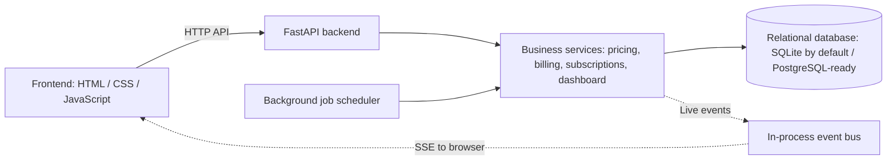

<div align="center">

# Brightloop
### Subscription Management & Recurring Billing Platform

A modern full-stack subscription operations system designed to streamline billing, customer lifecycle management, revenue tracking, and operational visibility across admin, staff, and customer roles.

[Overview](#overview) · [Features](#features) · [Architecture](#architecture) · [How it works](#how-it-works) · [Setup](#setup) · [Usage](#usage)

</div>

---

## Overview

Brightloop is a subscription management platform built to handle the full lifecycle of recurring services — from product catalog setup and quotation generation to billing, invoice tracking, payment updates, and customer self-service.

It is designed with a business-first mindset: operational efficiency, data integrity, and a clean user experience. The platform supports multiple roles, automated billing workflows, lifecycle controls, and a dashboard that gives real-time visibility into subscription health and revenue performance.

This project demonstrates a strong mix of backend engineering, business logic modeling, API design, database integrity, and frontend usability — making it a strong example of a production-style SaaS application built from scratch.

---

## Why this project stands out

- End-to-end subscription lifecycle management
- Role-based access for admins, billing staff, and customers
- Automated recurring billing and invoice generation
- Real-time dashboard updates without page reloads
- Business-rule-driven pricing, discounts, taxes, and payment handling
- Database-level safeguards to reduce operational mistakes and duplicate billing
- A clean separation between API logic, business services, and presentation

This is not just a CRUD application — it models real operational decisions that subscription businesses face every day.

---

## Features

### 1. Role-based access and user management
- Admins can manage platform configuration, users, and operational settings
- Billing staff can manage quotations, subscriptions, and invoice workflows
- Customers can access only their data and subscriptions
- Access is scoped to user roles to protect business and customer information

### 2. Subscription lifecycle management
- Draft, quotation, confirmed, active, paused, and closed states
- Subscription rules enforce valid transitions and operational flow
- Expired or inactive subscriptions can be auto-closed by the system

### 3. Recurring billing engine
- Supports daily, weekly, monthly, and yearly billing plans
- Generates invoices for due subscription periods automatically
- Handles billing cycles and recurring invoice logic in a structured manner
- Prevents duplicate invoice creation for the same subscription period

### 4. Product catalog and pricing
- Manage products and variants with configurable price differences
- Apply tax rules and pricing logic consistently
- Support commerce workflows that resemble real subscription businesses

### 5. Discounts and promotions
- Fixed and percentage discount support
- Usage limits and minimum purchase requirements
- Discount logic helps maintain pricing integrity while reducing revenue leakage

### 6. Invoice and payment workflows
- Generate and manage invoice records
- Confirm, send, and print invoice views
- Record partial payment activity and payment balances
- Support multiple payment scenarios while maintaining accounting consistency

### 7. Customer self-service experience
- Customer dashboard for viewing subscriptions and invoices
- Role isolation ensures each customer sees only their own records
- Supports realistic portal-style workflows for subscription visibility

### 8. Real-time operations dashboard
- Revenue, active subscriptions, overdue invoices, and KPI-style summary information
- Live event streaming keeps the dashboard updated in real time
- Helps teams monitor operational health without manual refreshes

### 9. Background automation
- Scheduled jobs handle recurring billing and maintenance tasks
- Built to resemble a real subscription platform’s day-to-day operational routines

### 10. Data-quality safeguards
- Composite database constraints help prevent duplicate invoice generation
- Indexed queries improve performance on high-volume subscription and billing data

---

## Architecture

Brightloop follows a clean 3-tier architecture:



### Backend
- Python
- FastAPI
- SQLAlchemy ORM
- Pydantic validation and settings
- JWT-based authentication and role checks

### Frontend
- HTML
- CSS
- Vanilla JavaScript
- Lightweight interface without heavy framework overhead
- Event-driven UI for dashboard interaction and real-time updates

### Data layer
- SQLite is used by default for easy local development
- PostgreSQL compatibility is supported by configuration
- Tables model users, taxes, products, plans, subscriptions, invoices, payments, and more

### Background processing
- APScheduler handles recurring operational jobs
- SSE-based updates push dashboard changes to connected clients

---

## How it works

### Step-by-step system flow

1. The user accesses the application through the frontend.
2. Authentication identifies the user role and grants the correct permissions.
3. Admins configure products, plans, taxes, and discounts.
4. Billing staff create or manage quotations and subscriptions.
5. Subscription logic validates status transitions and lifecycle rules.
6. Billing jobs generate invoices for due subscription periods.
7. Payments are recorded against invoices and balances are updated.
8. Dashboard metrics recalculate based on current subscription and invoice data.
9. SSE pushes updates to connected users in real time.

This gives the app the logic of a functioning recurring revenue platform rather than a mock interface.

---

## Tech stack

| Area | Tools and technologies |
|---|---|
| Backend | Python, FastAPI |
| Data access | SQLAlchemy ORM |
| Validation | Pydantic, Pydantic Settings |
| Auth & security | JWT, bcrypt, role-based access control |
| Frontend | HTML, CSS, JavaScript |
| Database | SQLite default, PostgreSQL-ready |
| Scheduling | APScheduler |
| Real-time updates | Server-Sent Events (SSE) |
| Local setup | Virtual environment, pip, uvicorn |

---

## Project structure

```text
backend/app/        API, models, services, routers, config
frontend/           Frontend assets and UI logic
requirements.txt    Python dependencies
seed.py             Demo data seeding
run.sh              macOS/Linux startup script
run.bat             Windows startup script
smoke_test.py       Smoke test suite
benchmark_perf.py   Performance benchmark script
.env.example        Environment template
README.md           Project documentation
```

---

## Setup

### Prerequisites
- Python 3.10+
- Git
- Windows, macOS, or Linux

### Quick start

```bash
git clone https://github.com/suraj-mm/subsription_management_system.git
cd subsription_management_system
```

#### Windows

```bat
run.bat
```

#### macOS / Linux

```bash
chmod +x run.sh
./run.sh
```

The startup script will:
- create `.env` if needed
- create a Python virtual environment
- install dependencies
- initialize the database
- seed demo users and records
- launch the application

### Manual setup

```bash
python -m venv venv

# Windows
.\venv\Scripts\Activate.ps1

# macOS / Linux
source venv/bin/activate

pip install -r requirements.txt
cp .env.example .env
python seed.py
uvicorn backend.app.main:app --host 0.0.0.0 --port 8000 --workers 1
```

Open the app here:
- Application: http://localhost:8000
- Swagger docs: http://localhost:8000/docs
- Health check: http://localhost:8000/health

---

## Demo accounts

The app includes pre-seeded demo credentials for exploring different user roles.

| Role | Email | Password |
|---|---|---|
| Administrator | `admin@brightloop.com` | `Admin@12345` |
| Billing Staff | `staff@brightloop.com` | `Staff@12345` |
| Customer | `tony@stark.org` | `Customer@12345` |
| Customer | `arjun@nexustech.io` | `Customer@12345` |
| Customer | `alex@acme.com` | `Customer@12345` |
| Customer | `rachel@globex.in` | `Customer@12345` |

These are development/demo credentials and should not be used in production environments.

---

## Usage

### For administrators
- Manage users and operational settings
- Configure products, plans, taxes, and discounts
- Review KPIs and system health
- Trigger billing operations and monitor platform activity

### For billing staff
- Create and manage quotations
- Generate and confirm subscriptions
- Work on invoices and billing workflows
- Monitor customer obligations and due payments

### For customers
- View subscription details
- Access invoice history
- See their payment status and subscription health
- Interact with a portal-like experience designed around self-service

---

## Business logic and technical depth

Brightloop is built around real business rules rather than static demo data.

### Included capabilities
- Subscription lifecycle controls
- Pricing and tax computation
- Discount evaluation
- Invoice and payment tracking
- Dashboard metrics and MRR-style business summaries
- Automated recurring billing workflows
- Duplicate-prevention safeguards at the database layer

### Important engineering choices
- Decimal-based financial calculations reduce floating-point errors
- Database constraints protect against duplicate revenue events
- Composite indexes improve query performance on billing and subscription operations
- Event-driven dashboard updates improve operational visibility

---

## Testing and validation

The project includes automated validation and benchmarking utilities.

### Run smoke tests

```bash
python smoke_test.py
```

### Run end-to-end checks

```bash
python test_phase1_e2e.py
python test_phase2_e2e.py
python test_phase3_e2e.py
```

### Run performance benchmark

```bash
python benchmark_perf.py
```

---

## Production considerations

This project is designed for local demonstration and development, but the architecture is aligned with real-world SaaS patterns. Before production deployment, it is important to harden:

- authentication and authorization policies
- environment configuration and secrets management
- database migration strategy
- backups and monitoring
- background job scaling
- event streaming for multi-instance deployments

The current SSE event bus is process-local and is best suited for a single-instance local environment or a controlled deployment model.

---

## Summary

Brightloop is a practical, business-focused subscription platform that brings together:

- subscription lifecycle management
- recurring billing automation
- customer-facing workflows
- dashboard visibility
- API-driven architecture
- strong engineering fundamentals

It reflects both business understanding and software engineering discipline, making it a compelling project for technical and product-focused audiences alike.

---

## License

No license file is currently included in the repository. Please review GitHub repository terms and usage permissions before reusing or redistributing this project.
