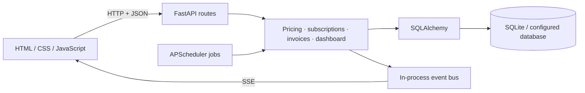

<div align="center">

# Brightloop
### Subscription Management & Recurring Billing

A full-stack platform for managing subscription lifecycles, invoices, payments, and billing operations.

**Python · FastAPI · SQLAlchemy · Vanilla JavaScript**

</div>

---

## Project Overview

Brightloop brings customer and product management, subscription plans, quotations, recurring invoices, payment tracking, and operational dashboards into one application. Role-based access supports administrators, billing staff, and customers.

## How the System Works

Administrators configure products, plans, taxes, and discounts. Staff manage quotations and subscriptions; customers view their own subscriptions and invoices. Subscription rules drive lifecycle changes, while scheduled jobs generate invoices for due cycles and close eligible expired subscriptions. Dashboard events are streamed to connected browsers using Server-Sent Events (SSE).

## System Architecture & Data Flow



Requests are validated, authenticated, and authorized before route handlers call business services. Services read or update relational records; billing and lifecycle jobs run on a schedule. Dashboard changes can be sent to connected clients through SSE. The event bus is in-process, so the current live-update design is intended for a single application process.

## Technology Stack

| Area | Technology |
|---|---|
| Backend/API | Python, FastAPI, Uvicorn |
| Persistence | SQLAlchemy 2, SQLite by default; configure another supported SQLAlchemy database URL as needed |
| Validation/config | Pydantic, Pydantic Settings |
| Authentication | JWT, bcrypt, role checks |
| Frontend | HTML, CSS, vanilla JavaScript |
| Background jobs | APScheduler |
| Live updates | Server-Sent Events (SSE) |

## Libraries & APIs

Key dependencies include `fastapi`, `uvicorn`, `sqlalchemy`, `pydantic[email]`, `pydantic-settings`, `pyjwt`, `bcrypt`, `apscheduler`, `python-dateutil`, `python-multipart`, and `httpx` (see [`requirements.txt`](requirements.txt)). The app exposes its REST API and interactive OpenAPI docs at `/docs`; `/health` is a basic health endpoint. SMTP settings are optional for email functionality. **Payments are recorded in the application; no external payment processor integration is configured.**

## Engine / Module Breakdown

- `backend/app/routers/` — authentication, admin, products, plans, taxes, quotations, subscriptions, discounts, invoices, payments, and dashboard endpoints.
- `backend/app/services/` — pricing, subscription lifecycle, invoice/billing, dashboard metrics, and event publishing.
- `backend/app/models.py`, `schemas.py`, `database.py` — relational models, request/response validation, and database setup.
- `backend/app/security.py`, `deps.py`, `config.py` — password/JWT helpers, request dependencies, and environment-backed settings.
- `frontend/` — browser UI and API client.
- `seed.py` — optional demo-data seeder; see the security note below.

## Local Setup

Requires Python 3.10+ and Git.

```bash
git clone https://github.com/suraj-mm/subsription_management_system.git
cd subsription_management_system
python -m venv .venv
```

Activate the virtual environment (`.venv\\Scripts\\Activate.ps1` on Windows, or `source .venv/bin/activate` on macOS/Linux), then:

```bash
pip install -r requirements.txt
cp .env.example .env   # Windows: copy .env.example .env
```

Edit `.env` and replace the development values before starting the app. Then run:

```bash
uvicorn backend.app.main:app --host 127.0.0.1 --port 8000 --workers 1
```

Open <http://localhost:8000> for the application, <http://localhost:8000/docs> for API docs, and <http://localhost:8000/health> for health status. The app creates its database schema on startup and creates the initial admin account from the configured admin environment variables. One worker is recommended because SSE uses an in-memory event bus.

## Environment Variables & Security

Configure these in your local `.env` file (never commit it):

| Variable | Purpose |
|---|---|
| `SECRET_KEY` | JWT signing secret; generate a unique, high-entropy value |
| `DATABASE_URL` | Database connection URL; defaults to local SQLite |
| `FRONTEND_URL` | Allowed frontend origin for CORS/reset links |
| `DEBUG` | Debug mode; disable outside local development |
| `ADMIN_EMAIL`, `ADMIN_PASSWORD` | Initial administrator account; set a unique, strong password before first startup |
| `SMTP_HOST`, `SMTP_PORT`, `SMTP_USER`, `SMTP_PASSWORD` | Optional mail delivery configuration |

**Security:** `.env.example` contains development defaults. Replace all secret and password values before use; do not expose this development configuration to the internet. Keep `.env`, database files, and credentials out of version control. `seed.py` creates demo accounts with fixed passwords, so run it only against a disposable local database. Use HTTPS, production-grade secret storage, and a hardened deployment configuration before any real-world deployment.

---

> This repository does not include a license file. Check with the maintainers before reusing or redistributing it.
